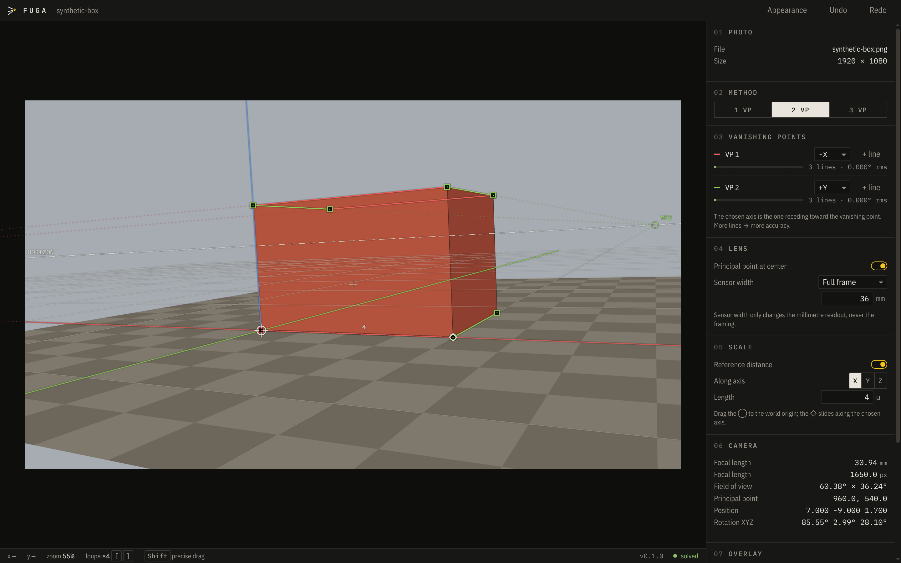

# Fuga

[](https://github.com/fugaapp/fuga/actions/workflows/build.yml)
[](LICENSE)
[](https://github.com/fugaapp/fuga/releases/latest)

Camera calibration from a single photo, using vanishing points. Trace
parallel edges in the photo; Fuga solves the focal length, rotation and
position of the camera and exports it for **Blender**, **Maya**, **USD**
(Houdini, Cinema 4D, Unreal…) or **JSON**.



## Download

**[fugaapp.github.io/fuga](https://fugaapp.github.io/fuga/download.html)** —
installers for Windows, macOS and Linux, plus the
[user guide (PDF)](site/assets/Fuga-User-Guide.pdf). The app tells you when a
new version is out.

## Build from source

Requires Node 22.12 or newer.

```bash
git clone https://github.com/fugaapp/fuga.git
cd fuga
npm install
npm run dev        # run the app
npm test           # solver and exporter tests
npm run dist       # build an installer for your OS (into release/)
```

To publish a version: set it in `package.json`, then *Actions → Release → Run
workflow*. The installers land in a draft release; publish it.

## How Fuga was made

Fuga was designed and directed by Gelain, a motion designer and 3D
generalist, to find the exact camera behind a photo (its lens, angle and
position) and bring it into 3D software, so the scene lines up with the
picture without trial and error. It was built with the help of AI. Every
result is checked by automated tests against cameras with known values, and
the source is public for anyone to review.
[Report a problem](https://github.com/fugaapp/fuga/issues).

## Privacy

Fuga collects no data. The only network request is an optional check for new
versions on GitHub. See [PRIVACY.md](PRIVACY.md).

## License

Copyright © 2026 Gelain. Free software under the
[GNU General Public License v3.0 or later](LICENSE).
