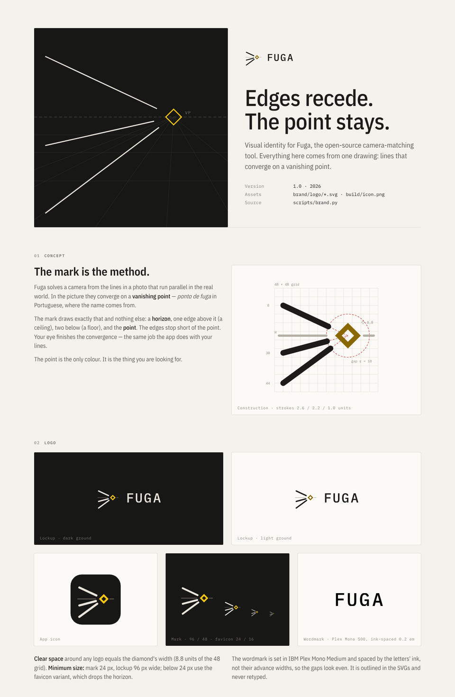

# Fuga — brand


Open **[guide.html](guide.html)** in a browser for the full brand guide
(concept, construction, colour, type, graphic language, misuse, voice).



## Assets

| File | Use |
| --- | --- |
| `logo/fuga-lockup-dark.svg` / `-light.svg` | Mark + wordmark, for dark / light grounds |
| `logo/fuga-mark.svg` / `-light.svg` | Mark alone, colour |
| `logo/fuga-mark-mono.svg` | Mark in one colour (`currentColor`) — engraving, stamps, single-ink print |
| `logo/fuga-wordmark.svg` | Wordmark alone (`currentColor`) |
| `logo/fuga-icon.svg` | App icon tile (source of `build/icon.png`) |
| `logo/fuga-favicon.svg` | Simplified mark for 16–24 px |
| `fonts/` | IBM Plex Mono and IBM Plex Sans Condensed (SIL OFL 1.1, see `fonts/OFL.txt`) |

Every logo file is generated by `scripts/brand.py` from one set of
constants — change the geometry or palette there, never by hand:

```bash
pip install fonttools brotli pillow
python3 scripts/brand.py
```

## Core palette

| Name | Hex | Role |
| --- | --- | --- |
| Graphite | `#171716` | dark ground |
| Paper | `#F4F2ED` | light ground |
| Chalk | `#E9E5DC` | ink on dark |
| Ink | `#1C1B19` | ink on light |
| Signal | `#F5C518` | the point; what is under your hand (dark grounds) |
| Signal deep | `#8A6800` | same role on light grounds (4.6 : 1) |
